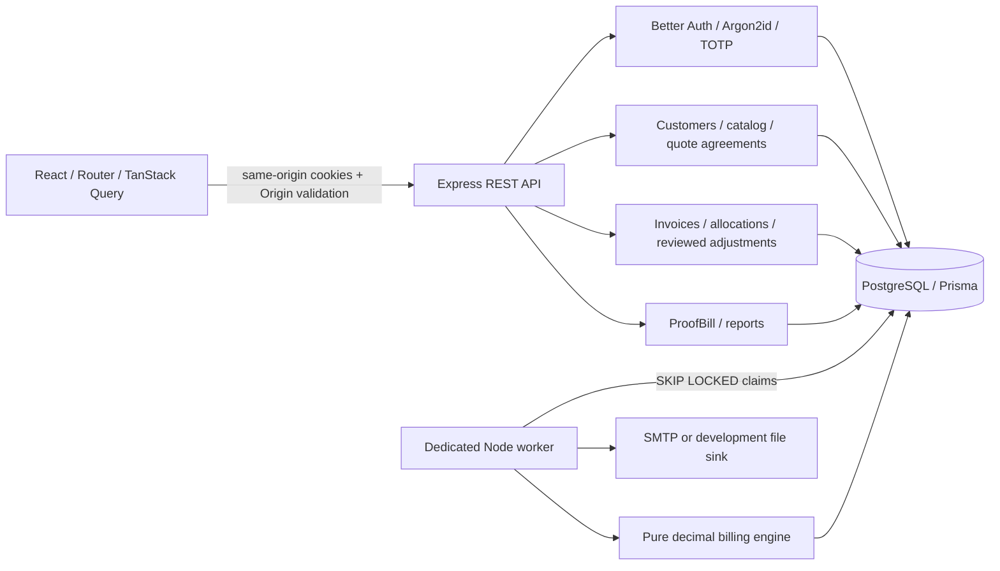
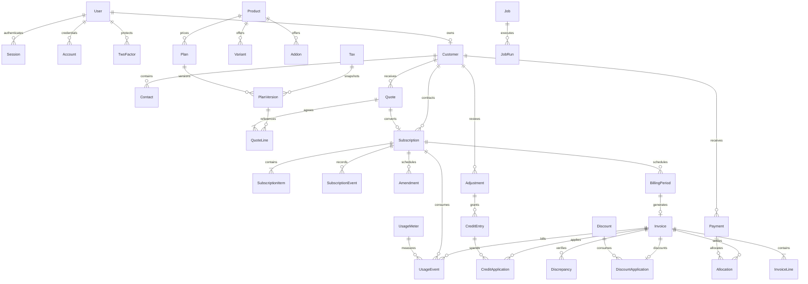

# Brightloop architecture

This is an original, single-company modular monolith with an independently running worker. The prior repository contained only a README describing React/FastAPI/SQLite; the supplied implementation prompt explicitly selected React/Express/PostgreSQL, so no existing application was replaced.

## Decisions

- Better Auth 1.7.14 APIs and the installed declarations were inspected before integration. Authentication uses its Prisma adapter, native email verification/reset/session mechanisms and TOTP plugin. Administrator and finance business routes reject accounts until MFA is enabled. Enrollment remains accessible through `/me` and `/api/auth`.
- Prisma 6.19.3 is pinned to retain its established Prisma adapter/schema/migration API. A patched `deepmerge-ts` override removes the CLI's vulnerable transitive version. A Prisma 7/8 upgrade requires a separate adapter/config migration. The project is tested on Node 24.9; Node 22.12+ is declared.
- Vite 7.3.7 is shared by the frontend and Vitest through an override. Mixing a Vite 8 plugin resolution with a nested Vite 7 install caused real transform failures during development; the unified lockfile fixes that issue.
- A small SQL-backed durable queue provides `SKIP LOCKED` claims, leases, retry delays, a five-attempt dead-letter state and job-run history. Graphile Worker is not required by the domain and is not installed.
- API modules own authorization and validation; shared service functions (`billOne`, `recordPayment`, `createQuote`) own transaction boundaries. Prisma provides the repository/data-access layer. A second wrapper around every Prisma model would not add an independent boundary.
- The pure billing package uses Decimal.js. PostgreSQL stores prices at scale 6 and financial document amounts at scale 2. UI chart numbers are presentation conversions, never financial inputs.
- UUIDs identify records. Human references use a year and random suffix, with a database uniqueness constraint and transactional retry. Human identifiers are not authorization credentials.
- Company-local calendar boundaries use Luxon and Asia/Kolkata by default. All persisted instants are UTC. Periods are `[start,end)`, and monthly anchor days are restored after shorter months.
- No business API returns paid status based on a browser assertion. Invoice payment state is derived from trusted allocations.

## Atomic billing transaction

1. Lock the subscription with a transaction-scoped PostgreSQL advisory lock.
2. Reject ineligible states and close expired contracts at their configured boundary.
3. Apply a pending next-period amendment and record the previous items in a lifecycle event.
4. Lock the customer's credits and applicable discount; re-read the global discount counter.
5. Calculate from the contract snapshot, unbilled usage, valid discount and unexpired credits.
6. Insert a unique billing period, draft invoice and lines.
7. Append discount/credit applications, attribute usage events and advance the cursor.
8. Append audit evidence and commit.

The worker can repeat a billing job safely. Two workers serialize per subscription, and unique `(subscriptionId,startAt)` periods and unique `Invoice.periodId` enforce the invariant independently. Serializable conflicts are retried. Catch-up is limited to 12 periods per job; the next cursor produces another durable job when more work remains.

Invoice notification delivery begins on confirmation, within the same transaction as the confirmation audit. Payments and other notifications likewise use an outbox. SMTP delivery is at least once: a crash after the SMTP server accepts a message and before `SENT` commits can resend it. Stable message IDs help receivers deduplicate.

## Database relationships

SQL migrations add nonnegative/positive checks, immutable issued invoices and accepted quotes, and append-only audit, credit, payment, allocation and billing-period tables. An owning database administrator can still disable triggers; restricted production credentials and external audit backups are essential.
